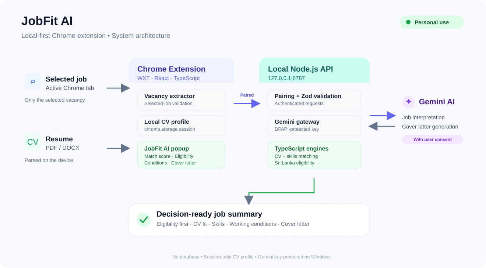

# JobFit AI

JobFit AI is a local-first Chrome extension that compares a job vacancy with a candidate's CV and highlights match, eligibility, and application considerations.

It extracts and scores requirements on the user's device, uses Google Gemini only when the user explicitly opts in, and keeps Gemini credentials and pairing authentication in Windows-protected storage.

## What it does

- Reads PDF or DOCX CV documents locally.
- Extracts skills, experience, education, responsibilities, and evidence from a candidate profile.
- Analyzes the currently open vacancy or accepts manually pasted vacancy text.
- Calculates technical and overall CV match scores.
- Checks geographic eligibility and work authorization against the vacancy.
- Identifies required qualifications, missing evidence, sponsorship details, and transferable skills.
- Generates editable cover-letter drafts with Gemini, with separate consent.
- Falls back to local analysis when Gemini is unavailable.

## Architecture



The repository is a pnpm monorepo:

```text
Chrome extension -> Localhost API -> Google Gemini API
       |                 |
  CV extraction    DPAPI credentials
  Job extraction   Pairing token
  Local scoring    Loopback-only server
```

| Area | Responsibility |
| --- | --- |
| `apps/extension` | WXT Chrome extension, React popup, CV parsing, vacancy extraction, session storage |
| `apps/local-api` | Loopback Node.js API, Gemini integration, pairing, and Windows DPAPI credentials |
| `packages/matching-engine` | Technical skill, experience, education, and overall matching |
| `packages/eligibility-engine` | Residence and work-authorization eligibility |
| `packages/job-extraction` | Job text and vacancy information extraction |
| `packages/cv-parser` | CV document parsing and candidate evidence extraction |
| `packages/shared-types` | Shared API and report types |
| `packages/validators` | Shared input validation |
| `packages/ai-service` | AI request and interpretation support |
| `packages/local-storage` | Local browser and credential-related storage support |
| `tests` | Unit, API, and browser tests |

## Privacy and security

- The local API listens only on `127.0.0.1:8787`.
- Sensitive API routes require a bearer pairing token.
- Requests are also restricted to the paired Chrome extension origin.
- Gemini API keys and pairing tokens use Windows DPAPI-protected credential files.
- CV profiles and pairing state use `chrome.storage.session`, not persistent browser storage.
- Gemini receives vacancy and selected CV evidence only after separate user consent.
- API inputs and provider responses are validated.
- Credentials and private CV contents are not written to application logs.

Google's Gemini API is an external service. Its terms and data-handling policies apply to text intentionally sent to Gemini.

## Requirements

- Windows 10 or Windows 11
- Google Chrome
- Node.js 22.15 or newer
- pnpm 12.18.0
- A Google Gemini API key for optional AI-assisted features

## Windows quick start

From the repository root in PowerShell:

```powershell
npm.cmd install --global pnpm@12.18.0
pnpm.cmd install --frozen-lockfile
pnpm.cmd build:extension
```

1. Open `chrome://extensions`.
2. Enable **Developer mode**.
3. Select **Load unpacked**.
4. Load `apps\extension\.output\chrome-mv3`.
5. Copy the extension ID, such as `abcdefghijklabcdefghijklmnop`.
6. Create `.jobfit-extension-id` in the repository root and place only that ID on the first line.

For hot reload, run `pnpm.cmd dev:extension` instead and load `apps\extension\.output\chrome-mv3-dev`.

Start the local API:

```powershell
Start-JobFit-AI.bat
```

Alternatively, run it in PowerShell:

```powershell
$env:JOBFIT_EXTENSION_ID = "<32-character extension ID>"
pnpm.cmd dev:api
```

Then:

1. Double-click `Pair-JobFit-AI.bat`.
2. Open **JobFit AI** in Chrome and go to **AI Settings**.
3. Paste the copied pairing token and select **Pair extension**.
4. Enter a Gemini API key, save it, and test the connection.
5. Upload a CV and analyze an open vacancy.

The complete setup, credential behavior, and troubleshooting guide is in [docs/local-setup.md](docs/local-setup.md).

## Daily usage

1. Start `Start-JobFit-AI.bat` and keep its console open.
2. Upload a PDF or DOCX CV in **CV Profile**.
3. Review candidate details and recognized evidence.
4. Open a vacancy in Chrome.
5. Open JobFit AI and select **Job Analysis** → **Analyze Current Job**.
6. Grant Gemini consent if you want AI-assisted interpretation.
7. Review eligibility, match scores, requirements, and evidence.
8. Generate a cover letter only if needed.

Use manual vacancy text for restricted or unsupported pages.

## Configuration

| Setting | Default | Description |
| --- | --- | --- |
| `JOBFIT_EXTENSION_ID` | Required | The loaded Chrome extension ID |
| `JOBFIT_GEMINI_MODEL` | `gemini-3.1-flash-lite` | Gemini model name for AI-assisted features |
| API address | `http://127.0.0.1:8787` | Local-only backend |

Example:

```powershell
$env:JOBFIT_EXTENSION_ID = "<32-character extension ID>"
$env:JOBFIT_GEMINI_MODEL = "gemini-3.1-flash-lite"
pnpm.cmd dev:api
```

## Development commands

```powershell
# Start development
pnpm.cmd dev:extension
pnpm.cmd dev:api

# Build
pnpm.cmd build:extension
pnpm.cmd build:api

# Package the extension
pnpm.cmd zip:extension

# Quality checks
pnpm.cmd typecheck
pnpm.cmd lint
pnpm.cmd test
```

Browser tests:

```powershell
pnpm.cmd exec playwright install chromium --no-shell
pnpm.cmd test:browser
```

The browser suite runs against an isolated Chrome profile and mock local API. Set `JOBFIT_TEST_CHROME` to an existing Chrome for Testing executable if needed.

## Scoring behavior

- Technical match combines required and preferred skills.
- Overall match combines technical skills, experience, and education evidence.
- Scores are renormalized across dimensions that have enough evidence.
- Insufficient evidence produces `Unknown` rather than an unsupported percentage.
- Eligibility is reported independently from the match percentage.
- Ambiguous location or work-authority information remains unresolved.
- Local extraction is conservative and can miss image-only PDFs or unusual vacancy layouts.

All results are advisory. Candidates should review the cited evidence and confirm application conditions with the employer.

## Limitations

- Designed primarily for Windows and Chrome.
- Gemini support requires network access and a valid API key.
- Text must be readable for PDF or DOCX parsing.


## Documentation

- [Windows setup and troubleshooting](docs/local-setup.md)
- [Architecture diagram](docs/architecture.svg)
- [Browser extension package](apps/extension/README.md)
